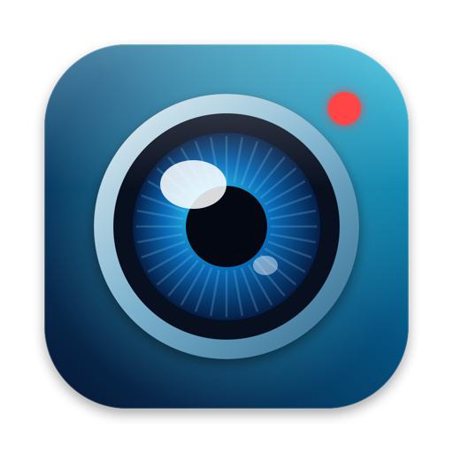

<p align="center">
  
</p>

<h1 align="center">Vedetta</h1>

<p align="center">
  <b>L'app Mac native et rapide pour vos caméras de surveillance et vos NVR.</b><br>
  Direct, enregistrements avec calendrier et chronologie, export MP4, événements et notifications.<br>
  TP-Link VIGI · Hikvision · Dahua · Reolink · Uniview · tout appareil ONVIF ou RTSP.
</p>

<p align="center"><a href="README.md">English</a> · <a href="README.it.md">Italiano</a></p>

---

Vedetta remplace les lourds logiciels de vidéosurveillance pour Windows (souvent utilisés sur Mac via
Wine/CrossOver) par une app vraiment native : décodage vidéo matériel, interface Liquid Glass pour
macOS 26 et consommation minimale — **16 caméras en direct à 10–13 % de CPU** sur un Mac Apple Silicon.

## Fonctions

- **Direct** — grilles de 1, 4, 6, 8, 9 et 16 cases, pages et rotation automatique, glisser-déposer des
  caméras, plein écran, fenêtres séparées pour d'autres écrans, zoom numérique, audio, captures et
  enregistrement MP4 sur le Mac. Les petites cases utilisent le flux léger, les cases agrandies la haute qualité.
- **Enregistrements** — calendrier des jours enregistrés, chronologie de 24 h zoomable avec interruptions
  d'enregistrement et événements colorés (mouvement, personnes, véhicules, franchissement de ligne,
  intrusion…), lecture synchronisée jusqu'à 4 caméras, pause, image par image, ±10 s, événement
  précédent/suivant, vitesse si prise en charge.
- **Export MP4** — enregistrez n'importe quelle plage ou événement sur le Mac **sans réencodage**, avec file
  d'attente, progression, annulation, nouvelle tentative et reprise après redémarrage.
- **Événements et notifications** — liste quotidienne filtrable et notifications macOS ; un clic ramène au moment.
- **PTZ** — joystick, zoom, vitesse et positions enregistrées pour les caméras ONVIF motorisées.
- **Appareils** — détection automatique sur le réseau, configuration en un écran, renommage/masquage des
  canaux, interface web de l'appareil intégrée pour les réglages avancés.
- **Efficace et confidentielle** — les flux s'arrêtent quand la fenêtre est masquée ; mots de passe dans le
  trousseau ; aucun compte, aucun cloud, aucune télémétrie.
- **Multilingue** — français, anglais, italien : suit la langue de macOS, modifiable dans les Réglages.

## Appareils pris en charge

| Appareil | Direct | Enregistrements | Événements |
|---|:-:|:-:|:-:|
| NVR **TP-Link VIGI** | ✓ | ✓ | ✓ + notifications |
| **NVR ONVIF de toutes marques** (Hikvision, Dahua, Uniview, Reolink…) | ✓ | ✓ avec ONVIF Profile G | ✓ + notifications |
| NVR **Hikvision / Dahua** sans ONVIF (RTSP) | ✓ | ✓ en choisissant l'heure | – |
| NVR **Reolink / Uniview** sans ONVIF (RTSP) | ✓ | – | – |
| **Caméras ONVIF** de toutes marques, y compris PTZ | ✓ + PTZ | ✓ si elles enregistrent (Profile G) | ✓ |
| Tout flux **RTSP** | ✓ | – | – |

## Configuration requise et installation

macOS 26 ou ultérieur, Mac Apple Silicon.

1. Téléchargez `Vedetta-x.y.z-macOS.dmg` depuis la [dernière version](https://github.com/TX-Breaker/vedetta/releases/latest).
2. Faites glisser **Vedetta** dans **Applications**.
3. Si macOS indique qu'il ne peut pas vérifier le développeur : clic droit sur Vedetta → **Ouvrir**
   (ou `xattr -dr com.apple.quarantine /Applications/Vedetta.app`).
4. Autorisez l'accès au **Réseau local** quand macOS le demande.
5. Choisissez quoi connecter, saisissez le mot de passe : c'est prêt.

## Compiler depuis les sources

```bash
git clone https://github.com/TX-Breaker/vedetta.git && cd vedetta
scripts/build-app.sh --install
```

Tests : `swift test` et `scripts/regression.sh` (nécessitent `brew install mediamtx ffmpeg`).
Traductions : `Resources/Localization/strings.tsv` + `python3 scripts/l10n.py`.

## Avertissement

Vedetta est un projet open source indépendant, **ni affilié ni approuvé** par TP-Link, Hikvision, Dahua,
Reolink, Uniview, EZVIZ ou ONVIF. Les marques appartiennent à leurs propriétaires respectifs et ne sont
citées que pour indiquer la compatibilité.

Licence [MIT](LICENSE).
