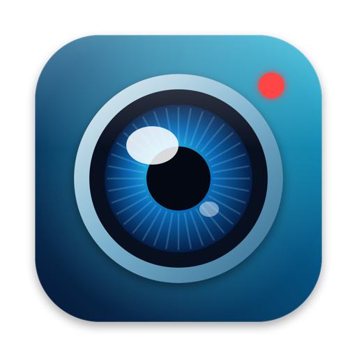

<p align="center">
  
</p>

<h1 align="center">Vedetta</h1>

<p align="center">
  <b>L'app nativa e veloce per Mac per le tue telecamere e i tuoi NVR.</b><br>
  Diretta, registrazioni con calendario e timeline, esportazione MP4, eventi e notifiche.<br>
  TP-Link VIGI · Hikvision · Dahua · Reolink · Uniview · qualsiasi dispositivo ONVIF o RTSP.
</p>

<p align="center"><a href="README.md">English</a> · <a href="README.fr.md">Français</a></p>

---

Vedetta sostituisce i pesanti programmi di videosorveglianza per Windows (spesso usati sul Mac tramite
Wine/CrossOver) con un'app davvero nativa: decodifica video hardware, interfaccia Liquid Glass per
macOS 26 e consumi minimi — **16 telecamere in diretta al 10–13 % di CPU** su un Mac Apple Silicon.

## Funzioni

- **Diretta** — griglie da 1, 4, 6, 8, 9 e 16 riquadri, pagine e giro automatico, trascinamento delle
  telecamere, schermo intero, finestre separate per altri monitor, zoom digitale, audio, istantanee e
  registrazione MP4 sul Mac. I riquadri piccoli usano il flusso leggero, quelli ingranditi l'alta qualità.
- **Registrazioni** — calendario con i giorni registrati, timeline di 24 ore con zoom, pause di
  registrazione ed eventi colorati (movimento, persone, veicoli, attraversamento linea, intrusione…),
  riproduzione sincronizzata fino a 4 telecamere, pausa, fotogramma per fotogramma, ±10 s, evento
  precedente/successivo, velocità se supportata.
- **Esportazione MP4** — salva qualsiasi intervallo o singolo evento sul Mac **senza ricodifica**, con coda,
  avanzamento, annullamento, nuovo tentativo e ripresa dopo il riavvio.
- **Eventi e notifiche** — elenco giornaliero con filtri e notifiche macOS; un clic riporta al momento.
- **PTZ** — joystick, zoom, velocità e posizioni salvate per le telecamere ONVIF motorizzate.
- **Dispositivi** — ricerca automatica in rete, configurazione in una schermata, rinomina/nascondi canali,
  interfaccia web del dispositivo dentro l'app per le impostazioni avanzate.
- **Efficiente e riservata** — gli stream si fermano quando la finestra è nascosta; password nel
  Portachiavi; nessun account, nessun cloud, nessuna telemetria.
- **Multilingua** — italiano, inglese, francese: segue la lingua di macOS e si può cambiare nelle Impostazioni.

## Dispositivi supportati

| Dispositivo | Diretta | Registrazioni | Eventi |
|---|:-:|:-:|:-:|
| NVR **TP-Link VIGI** | ✓ | ✓ | ✓ + notifiche |
| **NVR ONVIF di qualsiasi marca** (Hikvision, Dahua, Uniview, Reolink…) | ✓ | ✓ con ONVIF Profile G | ✓ + notifiche |
| NVR **Hikvision / Dahua** senza ONVIF (RTSP) | ✓ | ✓ scegliendo l'orario | – |
| NVR **Reolink / Uniview** senza ONVIF (RTSP) | ✓ | – | – |
| **Telecamere ONVIF** di qualsiasi marca, anche PTZ | ✓ + PTZ | ✓ se registrano (Profile G) | ✓ |
| Qualsiasi flusso **RTSP** | ✓ | – | – |

## Requisiti e installazione

macOS 26 o successivo, Mac con Apple Silicon.

1. Scarica `Vedetta-x.y.z-macOS.dmg` dall'[ultima release](https://github.com/TX-Breaker/vedetta/releases/latest).
2. Trascina **Vedetta** in **Applicazioni**.
3. Se macOS dice che non può verificare lo sviluppatore: clic destro su Vedetta → **Apri**
   (oppure `xattr -dr com.apple.quarantine /Applications/Vedetta.app`).
4. Consenti l'accesso alla **Rete locale** quando macOS lo chiede.
5. Scegli cosa collegare, inserisci la password: fatto.

## Compilare dal sorgente

```bash
git clone https://github.com/TX-Breaker/vedetta.git && cd vedetta
scripts/build-app.sh --install
```

Test: `swift test` e `scripts/regression.sh` (servono `brew install mediamtx ffmpeg`).
Traduzioni: `Resources/Localization/strings.tsv` + `python3 scripts/l10n.py`.

## Avvertenza

Vedetta è un progetto open source indipendente, **non affiliato né approvato** da TP-Link, Hikvision, Dahua,
Reolink, Uniview, EZVIZ o ONVIF. I marchi appartengono ai rispettivi proprietari e sono citati solo per
indicare la compatibilità.

Licenza [MIT](LICENSE).
