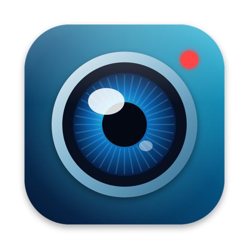

<p align="center">
  
</p>

<h1 align="center">Vedetta</h1>

<p align="center">
  <b>A fast, native Mac app for your security cameras and NVRs.</b><br>
  Live view, recordings with calendar and timeline, MP4 export, events and notifications.<br>
  TP-Link VIGI · Hikvision · Dahua · Reolink · Uniview · any ONVIF or RTSP device.
</p>

<p align="center">
  <a href="https://github.com/TX-Breaker/Vedetta/releases/latest"></a>
  
  
  
  <a href="LICENSE"></a>
  <a href="https://github.com/TX-Breaker/Vedetta/actions"></a>
</p>

---

Vedetta replaces heavyweight Windows video-management software (often run on the Mac through
Wine/CrossOver) with a truly native app: hardware video decoding, a Liquid Glass interface for macOS 26,
and a tiny CPU footprint — **16 cameras live at ~10–13 % CPU** on an Apple Silicon Mac, where the Windows
client under CrossOver used a full core and about 2 GB of memory for the same grid.

<!-- SCREENSHOTS -->

<p align="center">
  
</p>

| | Windows client under CrossOver | Vedetta |
|---|---|---|
| CPU for a live grid | 100–150 % of a core | ~10–13 % for 16 cameras |
| Memory | ~2 GB | ~230 MB |
| Video decoding | software, emulated | Apple media engine (VideoToolbox) |
| Recorder brands | VIGI only | VIGI, ONVIF of any brand, Hikvision, Dahua, Reolink, Uniview, RTSP |

Why it exists, the day an early build locked a real recorder, and how it was built:
**[the story of Vedetta](docs/STORY.md)**.

## Features

- **Live view** — grids of 1, 4, 6, 8, 9 and 16 tiles, pages and automatic tour, drag a tile onto another
  to swap cameras, full screen, separate windows for other monitors, digital zoom, audio. Small tiles use the
  light sub-stream, enlarged tiles high quality; **snapshots and recordings always use the full-quality stream**.
  Camera names always / on hover / never; pictures fit, fill or stretch (no cropping of the camera clock).
- **Recordings** — month calendar with recording days, zoomable 24-hour timeline with recording gaps and
  colour-coded events (motion, people, vehicles, line crossing, intrusion…), synchronized playback of up
  to 4 cameras, pause, frame-by-frame, ±10 s, jump to previous/next event, speed control when supported.
  **Keyboard shortcuts** (single keys) and **one-hand mouse use**: the wheel zooms the timeline around the
  pointer, buttons zoom/scroll/set the selection.
- **Export to MP4** — save any time range or single event on your Mac with **no re-encoding**
  (H.264/H.265 as recorded), with or without audio, queue with progress, cancel, retry and resume after restart.
- **Events & notifications** — daily event list with filters; macOS notifications for new detections;
  click a notification to replay the moment.
- **PTZ** — joystick, zoom, speed and saved positions for motorized ONVIF cameras.
- **Devices** — automatic discovery on the local network (WS-Discovery), one-screen setup, channel
  renaming/hiding, and the device web interface inside the app for advanced settings.
- **Efficient** — streams pause when the window is hidden or the Mac sleeps, reconnect automatically,
  and share one connection per camera.
- **Safe for your recorder's accounts** — one shared session per recorder, one login attempt at a time,
  no login at all while the recorder is unreachable (only password-free checks with growing pauses),
  and a refused password or a locked user stops every automatic attempt: your NVR never locks the user
  or sounds its buzzer because of Vedetta. Sign out / switch user from the app menu or Settings.
- **Settings that last** — saved as you change them, readable across versions (a damaged file is set aside
  and the backup used), File › Export/Import Settings (everything except passwords).
- **Private** — passwords stay in the macOS Keychain; Vedetta only talks to devices on your network.
  No accounts, no cloud, no telemetry.
- **Multilingual** — English, Italian and French. Vedetta follows the language of macOS and can be
  switched in Settings.

## Supported devices

| Device | Live | Recordings (calendar, timeline, export) | Events |
|---|:-:|:-:|:-:|
| **TP-Link VIGI** recorders (NVR) | ✓ | ✓ | ✓ + notifications |
| **ONVIF recorders of any brand** (Hikvision, Dahua, Uniview, Reolink…) | ✓ | ✓ with ONVIF Profile G | ✓ + notifications |
| **Hikvision / Dahua** recorders without ONVIF (RTSP) | ✓ | ✓ by picking a time (no recording list) | – |
| **Reolink / Uniview** recorders without ONVIF (RTSP) | ✓ | – | – |
| **ONVIF cameras** of any brand, including PTZ | ✓ + PTZ | ✓ if the camera records (Profile G) | ✓ |
| Any **RTSP** stream | ✓ | – | – |

Video: H.264 and H.265/HEVC. Audio: G.711 (µ-law/A-law), AAC, PCM.

## Requirements

- macOS 26 (Tahoe) or later, Apple Silicon.
- Cameras/NVR reachable on your network (or through a VPN such as Tailscale/WireGuard for remote access).

## Install

1. Download `Vedetta-x.y.z-macOS.dmg` from the [latest release](https://github.com/TX-Breaker/Vedetta/releases/latest).
2. Drag **Vedetta** to **Applications**.
3. First launch: if the build is not notarized, macOS may say it cannot verify the developer.
   Right-click Vedetta → **Open**, or run `xattr -dr com.apple.quarantine /Applications/Vedetta.app`.
4. Allow **Local Network** access when macOS asks — Vedetta needs it to find and reach your devices.
5. Choose what to connect (VIGI NVR, NVR of another brand, ONVIF camera or RTSP address), enter the
   password, done.

## Build from source

```bash
git clone https://github.com/TX-Breaker/Vedetta.git
cd vedetta
scripts/bootstrap.sh               # checks the requirements (changes nothing)
scripts/build-app.sh --install     # builds dist/Vedetta.app, installs it in /Applications and pins it to the Dock
```

Requires the macOS 26 SDK (Xcode 26+ or the Command Line Tools with the 26.x SDK) and Swift 6.2+.
Package a release with `scripts/package.sh` (zip + DMG + SHA-256; optional notarization).
Copy the project to another computer with `scripts/export-source.sh` — see [docs/moving-to-another-computer.md](docs/moving-to-another-computer.md).

## Tests

```bash
swift test                        # unit tests
scripts/regression.sh             # full regression: protocols against local mock NVRs, in-app end-to-end
                                  # self tests in IT/EN/FR, reconnection, account protection (recorder offline
                                  # 2 min, refused password, locked user, sign out, switch user),
                                  # 16-camera performance, hangs, memory
```

The regression suite needs `mediamtx` and `ffmpeg` (`brew install mediamtx ffmpeg`) and runs entirely on
your Mac — no real camera required.

## Translations

All texts live in one table, [`Resources/Localization/strings.tsv`](Resources/Localization/strings.tsv)
(English key · Italian · French). Run `python3 scripts/l10n.py` to regenerate the macOS `.strings`
files and check that nothing is missing. New languages are welcome — see [CONTRIBUTING.md](CONTRIBUTING.md).

## Architecture

Swift packages, no third-party runtime dependencies:

| Module | Role |
|---|---|
| `RTSPKit` | RTSP/RTP client (TCP interleaved, Digest/Basic auth), H.264/H.265/AAC/G.711 depacketizers |
| `MediaKit` | VideoToolbox display layer, audio playback, MP4 writer without re-encoding, snapshots |
| `ONVIFKit` | WS-Discovery, SOAP with WS-Security, media, PTZ, Profile G recording search and replay |
| `VigiKit` | TP-Link VIGI NVR JSON API (login, channels, recording search, events) |
| `VedettaCore` | Devices, live stream pool, synchronized playback, exports, brand-neutral playback backends |
| `Vedetta` | SwiftUI app (Liquid Glass) |

More in [docs/ARCHITECTURE.md](docs/ARCHITECTURE.md).

## Account safety

Recorders lock a user (and often sound their buzzer) after a few failed logins. Vedetta is built never to
cause that:

- **One session per recorder**, shared by live view, recordings, events and exports. Video streams start
  only after the credentials have been confirmed.
- **Network problems never cause logins.** When the recorder stops answering, Vedetta checks it without
  sending the password, after 5 s, 10 s, 20 s… up to 5 minutes (with jitter), and reuses the existing
  session when it comes back.
- **One attempt at a time.** Features never log in in parallel.
- **Refused password or locked user → full stop.** No automatic attempt until you sign in again, or until
  the unlock time the recorder reported. Vedetta tells you why and shows the sign-in screen.
- **Sign out / Switch user** (app menu, Settings › Accounts, device card) closes the video, ends the session
  on the recorder (only locally if it is unreachable or the user is locked), deletes the saved password and
  returns to the sign-in screen.
- **Connection log** — every attempt with time, result and error code, without passwords:
  `~/Library/Application Support/Vedetta/Logs/connections.log` (Settings › Accounts › Connection log).

**Use a dedicated user.** Create a user on the recorder with view-only permissions (live view and
playback) just for Vedetta, instead of `admin`: the admin account and the recorder's own apps stay
unaffected whatever happens.

## Documentation

Everything is in [docs/](docs/README.md): [user guide](docs/user-guide.md), [keyboard shortcuts](docs/keyboard-shortcuts.md), [troubleshooting](docs/troubleshooting.md), [account protection](docs/account-protection.md), [settings and data](docs/settings-and-data.md), [developer guide](docs/developer-guide.md), [moving to another computer](docs/moving-to-another-computer.md).

## Privacy & security

Passwords are stored only in the macOS Keychain. Self-signed device certificates are pinned on first use
and you are warned if they change. Vedetta makes no connections outside your local network.
Report vulnerabilities as described in [SECURITY.md](SECURITY.md).

## Disclaimer

Vedetta is an independent open-source project. It is **not affiliated with, endorsed by or sponsored by**
TP-Link, Hikvision, Dahua, Reolink, Uniview, EZVIZ or the ONVIF organization. All trademarks belong to
their respective owners and are used only to describe compatibility. Interoperability with VIGI recorders
is based on their public web interface and documented RTSP/ONVIF endpoints.

## License

[MIT](LICENSE) © 2026 TX-Breaker and Vedetta contributors.
